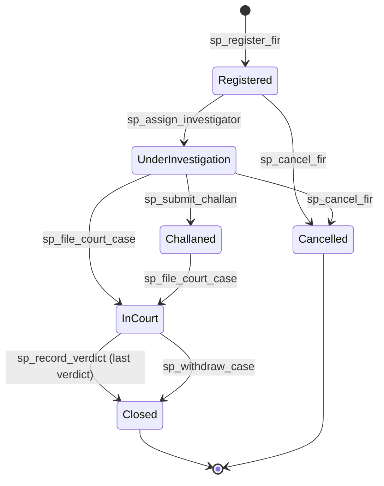

# FIR and Criminal Case Management System

**A relational database for First Information Reports, investigations, evidence, courts and verdicts, built in MySQL 8.0.**


The system keeps one connected record of a criminal case from the first report at a police station to the court's verdict. Every FIR, person, officer, exhibit, arrest, bail application, hearing and verdict is stored once and linked through keys. The database itself rejects impossible data: a case cannot reach court before it is investigated, an accused person cannot also be the complainant, digital evidence cannot be stored without its hash, and an exhibit cannot change hands without a log entry.

**Live demo:** https://fir-case-management.vercel.app (read-only web front end: FIR register, full case files, evidence chain of custody, courts, the 27 queries and the 45 rule tests)

> Course project in Database Management Systems, applied to Criminology and Criminal Justice. All people, FIRs and events in the sample data are **fictional**. The legal sections are reference data for illustration; check them against the current statutes before any real use.

---

## Contents

- [Live demo](#live-demo)
- [Project information](#project-information)
- [Problem statement](#problem-statement)
- [What the system covers](#what-the-system-covers)
- [Database at a glance](#database-at-a-glance)
- [Entity relationship diagram](#entity-relationship-diagram)
- [How a case moves through the system](#how-a-case-moves-through-the-system)
- [Getting started](#getting-started)
- [Try it: example calls](#try-it-example-calls)
- [Business rules the database enforces](#business-rules-the-database-enforces)
- [Views, procedures and triggers](#views-procedures-and-triggers)
- [Sample results](#sample-results)
- [Repository structure](#repository-structure)
- [Course topics covered](#course-topics-covered)
- [Limits and future work](#limits-and-future-work)

---

## Live demo

**https://fir-case-management.vercel.app** is a read-only front end for the database. It is plain HTML, CSS and JavaScript in [`web/`](web/) and shows a snapshot of the sample data exported from MySQL by `tools/export_web_data.py`: an overview dashboard, the FIR register, a full case file for every FIR (people, investigation, evidence with chain of custody, bail, court), people and criminal history, the court calendar, station scorecards, the 27 report queries with their results, and the 45 rule tests with MySQL's own error messages. The writable database itself runs on your own MySQL or with `docker compose up -d`.

---

## Project information

| | |
|---|---|
| **Project** | FIR and Criminal Case Management System |
| **Field** | Criminology and Criminal Justice |
| **DBMS** | MySQL 8.0.16 or newer (InnoDB, utf8mb4) |
| **Tools** | MySQL Workbench or the `mysql` command line, Git, Python 3 and Graphviz (only to regenerate the documents) |

---

## Problem statement

Traditional record-keeping systems often involve manual paperwork, which makes it difficult to search, update, maintain and analyze criminal records. A file for one case is spread over registers, diaries and cupboards. The same person is written with different spellings, an exhibit's movements are not recorded, and nobody can say quickly how many cases are waiting for an investigating officer or when the next hearing is.

This project replaces that with **one normalized relational database**:

- every person, FIR, officer and exhibit is stored **once** and connected through keys;
- the database **rejects invalid data** (impossible dates, wrong statuses, orphan records, duplicate ID numbers);
- multi-step actions such as registering an FIR or recording a verdict run as **atomic transactions**;
- officers and courts get **ready-made reports** through views and stored procedures.

---

## What the system covers

| Area | What is stored |
|---|---|
| **FIR** | Station, serial number, incident and report time, complainant (a person or the State), sections of law, category, description, status and its full history |
| **People** | One record per person: ID card number, family, date of birth, address. The same person can be complainant, victim, witness or accused in different FIRs |
| **Police** | Stations, districts, ranks, officers with their supervisor, and login users with roles |
| **Investigation** | Assigned investigating officer (one at a time, with history), case diary, arrests with remand days |
| **Evidence** | Exhibits with type, collector, custodian, storage place and SHA-256 hash for digital items. Every hand-over is logged. Forensic lab reports |
| **Courts** | Courts, judges, cases, hearings with next dates, bail applications and decisions, verdicts and sentences |

Roles served: the **Station House Officer** (assigns cases and watches the workload), the **Investigating Officer** (case diary, arrests, evidence), the **Records Clerk** (registers FIRs and persons), the **Court Liaison Officer** (cases, hearings, verdicts), the **Auditor** (read-only) and the **Administrator**.

---

## Database at a glance

| | |
|---|---|
| Tables | 27, all in third normal form |
| Constraints | 27 primary keys, 44 foreign keys, 24 UNIQUE keys, 25 CHECK constraints, one generated column |
| Triggers | 23 |
| Stored procedures | 13 (10 write procedures with transactions, 3 read-only lookups) |
| Stored functions | 3 |
| Views | 8 |
| Report queries | 27, all run and documented in [docs/QUERY_RESULTS.md](docs/QUERY_RESULTS.md) |
| Integrity tests | 45 rule-breaking attempts, all rejected: [docs/INTEGRITY_TESTS.md](docs/INTEGRITY_TESTS.md) |
| Sample data | 24 FIRs in 8 stations, 63 persons, 28 officers, 35 exhibits, 99 custody-log rows, 13 court cases |

The sample data tells complete stories. For example, FIR `CNT-0001/2026` is a murder case: it is registered, its investigation is **handed to a more senior officer** midway, an axe is collected, deposited in the Malkhana, sent to the laboratory, returned, produced in court and returned again (six custody-log entries written by a trigger), two accused are arrested, bail is rejected twice, and the Sessions Court trial is in progress.

---

## Entity relationship diagram


Colours: grey reference data, green people, orange FIR and investigation, red evidence, blue courts. A circle on a line means the link is optional. The full diagram with every column is in [docs/ERD.md](docs/ERD.md) (Mermaid, drawn by GitHub) and every column, key, constraint and trigger is listed in [docs/DATA_DICTIONARY.md](docs/DATA_DICTIONARY.md).

---

## How a case moves through the system



Every change of status is written to `fir_status_history` by a trigger. A `Closed` or `Cancelled` FIR cannot be re-opened and an FIR can never be deleted.

---

## Getting started

### Option 1: MySQL on your computer

```bash
mysql -u root -p < database/fir_ccms.sql
```

This one file builds the database `fir_ccms`: schema, triggers, procedures, views and sample data. It takes a few seconds. The three source files it is made from are `database/schema.sql`, `database/logic.sql` and `database/data.sql`; they can also be run one after the other in that order.

The scripts use `DELIMITER`, so load them with the `mysql` client or MySQL Workbench's "Run SQL Script", not by pasting into a single-statement window.

### Option 2: Docker

```bash
docker compose up -d
docker compose exec db mysql -uroot -pfirccms fir_ccms
```

The compose file starts MySQL 8.0 and loads `database/fir_ccms.sql` automatically on the first start.

### Run the reports and the tests

```bash
mysql -u root -p fir_ccms < database/queries.sql
python3 tools/run_integrity_tests.py
```

The test runner prints `45/45 rejected as expected; database unchanged: yes`. Set `MYSQL_CMD="mysql -h127.0.0.1 -uroot -pfirccms"` if your login differs.

---

## Try it: example calls

The sample data uses a simulated clock so history can be replayed. Leave it alone and everything uses the real time. To get the same output as the documents, fix "today" first:

```sql
USE fir_ccms;
SET @as_of = '2026-10-30 12:00:00';
```

**See the whole case file of one FIR** (seven result sets in one call):

```sql
CALL sp_fir_dossier(7);
```

**Find a person by ID card number or name** and see their criminal history:

```sql
CALL sp_person_profile('00000-0000005-5');
```

**Register a new FIR** at Riverside station (`sp_register_fir` allocates the serial number inside a transaction):

```sql
CALL sp_register_fir(1, 1, NULL, 5, '2026-10-30 08:30:00', 'Main Bazaar, Riverside', 2,
                     'Mobile phone snatched at the bazaar.', @fir_id, @fir_no);
SELECT @fir_id, @fir_no;
INSERT INTO fir_sections VALUES (@fir_id, 4);                  -- PPC 379
CALL sp_assign_investigator(@fir_id, 3, 'Assigned by the SHO'); -- moves it to Under Investigation
```

**Move an exhibit** and read its chain of custody:

```sql
CALL sp_transfer_evidence(2, 3, 'Sent to the investigating officer', 'With Investigator', NULL);
SELECT * FROM evidence_custody_log WHERE evidence_id = 2 ORDER BY transferred_at;
```

**Today's work lists**:

```sql
SELECT * FROM vw_cause_list WHERE days_until BETWEEN 0 AND 30;   -- court calendar
SELECT * FROM vw_stale_investigations;                           -- no diary entry for 30 days
SELECT * FROM vw_open_cases_by_officer ORDER BY open_cases DESC; -- workload
CALL sp_officer_caseload(3);                                     -- one officer's files
```

See what the database refuses:

```sql
DELETE FROM firs WHERE fir_id = 1;
-- ERROR 1644: FIRs are permanent records and cannot be deleted. Cancel the FIR instead.
```

(The calls above change data. Reload `database/fir_ccms.sql` to reset.)

---

## Business rules the database enforces

These live in the database, not in an application, so no screen, script or import can bypass them. Each rule has a test in [`database/integrity_tests.sql`](database/integrity_tests.sql).

| Area | Rule |
|---|---|
| FIR | Cannot be deleted. Closed or Cancelled FIRs cannot be re-opened. Number and registration time cannot change. Must be investigated before it is challaned, tried or closed. Cancelling needs a written reason. Registered by an officer of the same station. The incident cannot be later than the report. Exactly one complainant (a person or the State) |
| People | The complainant cannot be the accused. A person cannot be both accused and victim or witness in the same FIR. ID card numbers have a fixed format and are unique |
| Investigation | Only ranks marked `can_investigate` may lead a case, and only active officers. **Only one open investigating officer per FIR** (a unique key on a generated column). Only the assigned officer can write the case diary. Arrests cannot precede the incident, remand is at most 14 days, a person already in custody cannot be arrested again |
| Evidence | Digital evidence must have a valid SHA-256 hash, and the hash can never be changed. Evidence cannot be collected before the incident. It starts in the collector's custody. Every change of custodian writes the custody log, in time order. Returned or destroyed evidence cannot move again |
| Bail | Filed as Pending and decided once. Granting needs a surety amount, releases the accused and updates the accused status |
| Courts | A case needs an investigated FIR with at least one accused. The judge must sit in the court that holds the case. No hearings on a decided or withdrawn case. The next hearing is after this one |
| Verdicts | The accused must belong to the case's FIR. A conviction needs a sentence; an acquittal cannot carry one. The last verdict closes the case and the FIR in the same transaction |

---

## Views, procedures and triggers

**Views (8)**

| View | Answers |
|---|---|
| `vw_fir_register` | The FIR register: number, station, complainant, sections, status, investigating officer, reporting delay |
| `vw_open_cases_by_officer` | Active files per investigating officer and the age of the oldest |
| `vw_crime_by_district_category` | FIR counts by district and crime category |
| `vw_criminal_history` | Every time a person was named as accused, and how it ended |
| `vw_evidence_custody_status` | Where each exhibit is, who holds it and how often it has moved |
| `vw_stale_investigations` | Open investigations with no diary entry for more than 30 days |
| `vw_station_performance` | Workload and outcome per station |
| `vw_cause_list` | The court calendar: next hearing date of every open case |

**Stored procedures (13)** `sp_register_fir`, `sp_assign_investigator`, `sp_transfer_evidence`, `sp_register_arrest`, `sp_decide_bail`, `sp_submit_challan`, `sp_file_court_case`, `sp_record_verdict`, `sp_withdraw_case`, `sp_cancel_fir` (write, each in a transaction with rollback on error) and `sp_fir_dossier`, `sp_person_profile`, `sp_officer_caseload` (read).

**Functions (3)** `fn_fir_number` (prints `RVS-0007/2026`), `fn_age`, `fn_now` (the clock the logic uses; honours `@as_of`).

**Triggers (23)** cover the FIR life cycle and status history, the people rules, investigation assignment and the case diary, arrests, evidence and chain of custody, bail, courts, hearings and verdicts. Each trigger is listed under its table in [docs/DATA_DICTIONARY.md](docs/DATA_DICTIONARY.md).

---

## Sample results

Taken from [docs/QUERY_RESULTS.md](docs/QUERY_RESULTS.md) (clock fixed at 30 October 2026):

**Repeat offenders (Q07)**

| full_name | cnic | times_accused | firs |
|---|---|---:|---|
| Adnan Sheikh | 00000-0000005-5 | 2 | RVS-0002/2026, IND-0002/2026 |
| Rehan Lakhani | 00000-0000009-9 | 2 | CNV-0001/2026, OLD-0002/2026 |

**Investigations that have gone quiet (Q20)**

| fir_number | station | investigating_officer | last_activity | days_idle |
|---|---|---|---|---:|
| SDB-0001/2026 | Saddar Bazaar Police Station | Hamza Tariq | 2026-04-02 | 211 |
| IND-0002/2026 | Industrial Area Police Station | Adeel Anwar | 2026-08-02 | 89 |
| CNV-0003/2026 | Canal View Police Station | Rubina Akhtar | 2026-09-25 | 35 |

**Chain of custody of the axe in the murder case (Q09)**

| transferred_at | from_officer | to_officer | purpose |
|---|---|---|---|
| 2026-03-22 08:00 | (collected at scene) | Maryam Aslam | Collected at scene |
| 2026-03-22 20:00 | Maryam Aslam | Aslam Pervaiz | Deposit in Malkhana |
| 2026-03-23 09:00 | Aslam Pervaiz | Maryam Aslam | Sent for DNA and serology |
| 2026-04-19 11:00 | Maryam Aslam | Aslam Pervaiz | Returned from laboratory |
| 2026-07-01 08:30 | Aslam Pervaiz | Farhan Saeed | Produced in court |
| 2026-07-01 15:00 | Farhan Saeed | Aslam Pervaiz | Returned to Malkhana after hearing |

All 27 queries are there, including `GROUP BY ... WITH ROLLUP`, window functions (`RANK`, `LAG`), common table expressions, a recursive CTE over the chain of command, correlated sub-queries and pivots with `CASE`.

---

## Repository structure

```
database/
  schema.sql            27 tables, keys and constraints
  logic.sql             functions, 23 triggers, 13 procedures, 8 views
  data.sql              sample data (generated, replayed through the procedures)
  fir_ccms.sql          the three files above in one importable script
  queries.sql           27 report queries
  integrity_tests.sql   45 tests that must be rejected
docs/
  REQUIREMENTS.md       functional and non-functional requirements, traced to the design
  PROJECT_REPORT.md     full written report
  DATA_DICTIONARY.md    every table, column, constraint and trigger
  ERD.md, erd.png, erd.svg
  QUERY_RESULTS.md      the 27 queries with real output
  INTEGRITY_TESTS.md    the 45 tests with MySQL's own error messages
tools/
  generate_sample_data.py   writes database/data.sql
  run_integrity_tests.py    runs the tests and proves the data is unchanged
  build_docs.py             regenerates the documents from the live database
web/                        the live front end (index.html, styles.css, app.js, data.json)
docker-compose.yml
.github/workflows/mysql.yml   builds the database and runs the tests on every push
```

To rebuild everything after changing the SQL: `python3 tools/generate_sample_data.py > database/data.sql`, reload `database/fir_ccms.sql`, then `python3 tools/build_docs.py`.

---

## Course topics covered

| Topic | Where |
|---|---|
| Requirements and entity identification | [docs/REQUIREMENTS.md](docs/REQUIREMENTS.md), report sections 2 to 4 |
| ER modelling, cardinalities, supertype-free design of `persons` | [docs/ERD.md](docs/ERD.md) |
| Normalization (UNF, 1NF, 2NF, 3NF) | [docs/PROJECT_REPORT.md](docs/PROJECT_REPORT.md) section 5 |
| DDL: keys, UNIQUE, CHECK, generated columns, ENUM | `database/schema.sql` |
| Referential integrity | 44 foreign keys; tests T36 and T37 |
| Joins: inner, left, anti-join, self-join, recursive | Q02, Q16, Q19, Q23 |
| Aggregation, GROUP BY, HAVING, ROLLUP | Q03, Q04, Q07, Q14, Q22 |
| Sub-queries, correlated sub-queries, EXISTS | Q17, Q24, Q26 |
| Window functions and CTEs | Q05, Q09, Q21, Q23 |
| Views | 8 views, used by 15 of the 27 queries |
| Stored procedures, functions, error handling | `database/logic.sql` |
| Transactions and ACID | Every write procedure; report section 7.5 |
| Triggers | 23 triggers: audit trail, chain of custody, status automation, guard rules |
| Security basics | Role table, hashed passwords, least-privilege suggestion in the report |
| Testing | 45 integrity tests and 27 documented queries |

---

## Limits and future work

- The system is a database only. A web or desktop front end can be built on top; every rule is already inside the database.
- Passwords in the sample data are plain SHA-256 of a demo string. A real system must use a salted, slow hash (bcrypt or Argon2) in the application.
- Row-level access by role (for example a station seeing only its own FIRs) would be added with MySQL accounts and views.
- Possible extensions: fingerprint and photograph records, warrants and proclaimed offenders, prison records, SMS reminders for hearings, a map of crime by location.

## License

MIT, see [LICENSE](LICENSE).
